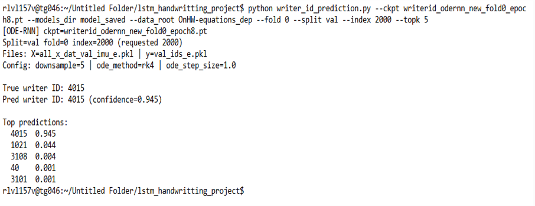

# lstm_ode_handwriting

This repository contains training and evaluation scripts for writer identification from IMU-based handwriting sequences. It implements two model families:

- BiLSTM-based classifier (in [main.py](lstm_ode_handwriting/main.py))
- ODE-RNN (neural ODE + GRU) classifier (in [main_ode.py](lstm_ode_handwriting/main_ode.py) + [neural_ode_model.py](lstm_ode_handwriting/neural_ode_model.py))

The code was used to train and evaluate models on OnHW datasets (words500 / equations) and stores checkpoints in `model_saved/`.

## Key files

- [main.py](lstm_ode_handwriting/main.py) — BiLSTM training script (writer-dependent experiments)
- [main_ode.py](lstm_ode_handwriting/main_ode.py) — ODE-RNN training script
- [neural_ode_model.py](lstm_ode_handwriting/neural_ode_model.py) — ODE-RNN model implementation (uses `torchdiffeq`)
- [evaluate_all.py](lstm_ode_handwriting/evaluate_all.py) — Evaluate checkpoints in `model_saved/` on validation splits
- [writer_id_prediction.py](lstm_ode_handwriting/writer_id_prediction.py) — Single-sample prediction / demo
- `model_saved/` — directory containing .pt checkpoint files

## Requirements

- Python 3.8+
- numpy, tqdm
- torchdiffeq (for ODE-RNN): `pip install torchdiffeq`

Suggested install (example):

```bash
python -m pip install numpy tqdm torchdiffeq
# install torch according to your platform, e.g.:
python -m pip install "torch" --index-url https://download.pytorch.org/whl/cpu
```

## Dataset layout

The training/eval scripts expect a dataset folder like `OnHW-equations_dep/0/` containing pickled files with names such as:

- `all_x_dat_train_imu_e.pkl`, `train_ids_e.pkl`
- `all_x_dat_val_imu_e.pkl`, `val_ids_e.pkl`

There are two variants in the repo: equations (suffix `_e.pkl`) and words500 (no `_e`). Each fold is placed under `OnHW-*/<fold>/`.

## Quick usage

Train BiLSTM (example):

```bash
python main.py --data_root OnHW-equations_dep --fold 0 --epochs 10 --batch 32 --hidden 128 --downsample 5 --lr 3e-4
```

Train ODE-RNN (example):

```bash
python main_ode.py --data_root OnHW-equations_dep --fold 0 --epochs 10 --batch 32 --hidden 128 --downsample 5 --lr 3e-4

```

Evaluate all checkpoints in `model_saved/` (prints a summary):

```bash
python evaluate_all.py --models_dir model_saved --data_root_base . --batch 32 --device cpu
```

Single-sample prediction (top-k) using a checkpoint:

```bash
python writer_id_prediction.py --ckpt writerid_odernn_fold0_best.pt --data_root OnHW-equations_dep --fold 0 --split val --index 0 --topk 5
```

## Checkpoints and expected keys

Checkpoint dictionaries saved by the scripts include keys such as:

- `model_state`, `id_to_idx`, `mean`, `std`, `feat_dim`, `num_writers`
- ODE checkpoints also include: `hidden_dim`, `downsample`, `ode_method`, `ode_step_size`, `model_type`

`evaluate_all.py` contains robust heuristics to infer dataset/fold from checkpoint names and keys — see its logic for details.

## predictions demo


